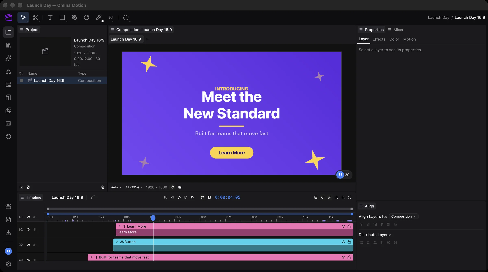
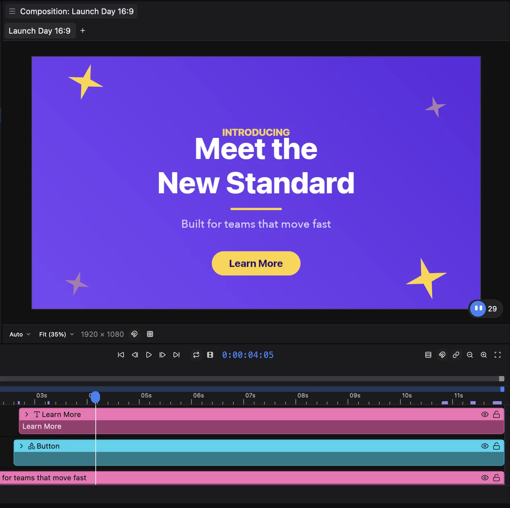

<div align="center">


# Omina Motion

**Motion graphics and video editing in one app.**<br>
Cut, animate and finish a video without switching programs.

[](https://github.com/OddOmens/Omina-Motion/releases/latest)
[](LICENSE)


**Download:**
[macOS](https://github.com/OddOmens/Omina-Motion/releases/latest/download/Omina-Motion-macOS.dmg) ·
[Windows](https://github.com/OddOmens/Omina-Motion/releases/latest/download/Omina-Motion-Windows-Setup.exe) ·
[Linux](https://github.com/OddOmens/Omina-Motion/releases/latest/download/Omina-Motion-Linux.AppImage)
&nbsp;|&nbsp; [Release notes](https://github.com/OddOmens/Omina-Motion/releases)

<br>



</div>

<br>

Omina Motion brings After Effects-style layers, keyframes and effects together with Premiere-style
editing. If you know either app, you'll feel at home: the tools, panels and keyboard shortcuts work
the way you expect. Everything, including captions and background removal, runs on your own computer.

Part of the Omina family, with [Omina Edit](https://github.com/OddOmens/Omina-Edit) for photo editing and
design, and [Omina Develop](https://github.com/OddOmens/Omina-Develop) for photo development.

## Contents

- [What it does](#what-it-does)
- [Install](#install)
- [Privacy](#privacy)
- [Build from source](#build-from-source)
- [License](#license)

## What it does

| | |
|---|---|
| 🎬 **Edit on a timeline** | Tracks with several clips each, a magnetic main track, and ripple, roll, slip, slide and rate-stretch trims. Split, separate audio, freeze frames, speed ramps and reverse. |
| ✨ **Animate anything** | Keyframes on every property, an easing graph editor, In / Out / Loop presets, text animators, shape morphing and Magic Move between two compositions. |
| 🎨 **Grade the color** | Basic correction, color wheels, a real point curve for brightness and each color, levels, vignette, and 48 built-in LUT looks shown before and after. Your own `.cube` files work too. iPhone HDR footage looks the way it does in QuickTime. |
| 💬 **Captions from speech** | Transcribed and timed on your machine, with animated caption styles. Import and export `.srt` and `.vtt`. |
| ✂️ **Remove backgrounds** | Click a subject and it's cut out, then followed through the clip. A green-screen keyer is built in too. |
| 🎯 **Track and stabilize** | Pin a graphic to a moving point, steady a shaky shot, or reframe a wide video for 9:16. |
| 🔊 **Clean up a voice** | Noise, hum and harsh "s" sounds removed, levelled to a standard loudness. Remove silences and mark the beats of a song. |
| 🧩 **Start from a template** | 73 animated templates in 16:9, 4:5 and 9:16, plus device mockups, elements, transitions and brand libraries. |
| 📦 **Export anywhere** | H.264, H.265, ProRes, WebM with transparency, GIF, PNG sequences or Lottie, with an export queue. |
| 💾 **Never lose work** | Auto-save copies into a folder beside your project, earlier versions to restore, and recovery after a crash. |

It also opens After Effects projects (`.aep`) and Lottie animations, and packages a project with all its
media into one zip.

<p align="center">
  
  <br><sub>The Launch Day template, four seconds in.</sub>
</p>

### Projects

Projects are saved as **`.omim`** files, which open in Omina Motion with a double-click. Projects saved with
the older `.studio` extension still open.

## Install

Download the file for your system from the [latest release](https://github.com/OddOmens/Omina-Motion/releases/latest).

| System | Needs | First launch |
|---|---|---|
| **macOS** | macOS 13 or later, Apple silicon | The app isn't signed with an Apple Developer ID yet, so macOS asks once. Open the app, close the warning, then go to **System Settings ▸ Privacy & Security** and choose **Open Anyway**. |
| **Windows** | Windows 10 or 11, 64-bit | The installer isn't signed yet, so Windows may warn you. Choose **More info**, then **Run anyway**. |
| **Linux** | A 64-bit (x86-64) desktop | Make the AppImage executable (`chmod +x`, or **Properties ▸ Permissions**), then open it. |

## Privacy

- **No accounts, no telemetry, no analytics.** Crash reports stay on your computer unless you send one.
- **AI runs locally.** Captions (Whisper) and background removal (MobileSAM) download their models once,
  after asking, and run on your own computer. Each download is checked against a known fingerprint (SHA-256).
- **Update checks**, when a build has them, are a plain request for a small file, with nothing about you in it.

Where files are kept, and what a shared project contains, is described in the
[developer guide](docs/ARCHITECTURE.md#privacy-and-security).

## Build from source

You need [Rust](https://rustup.rs) 1.90 or later and FFmpeg's libraries.

```bash
# macOS
brew install ffmpeg pkg-config

# Debian / Ubuntu
sudo apt install libavcodec-dev libavformat-dev libswscale-dev libswresample-dev libasound2-dev pkg-config clang
```

```bash
cargo run -p studio --release   # run the app
cargo test --workspace          # run every test
```

The [developer guide](docs/ARCHITECTURE.md) explains how the code is organized, the conventions it follows,
and how releases are made. Pushing a version tag (`v1.2.3`) builds the macOS, Windows and Linux installers
and attaches them to that release.

## License

Omina Motion is free software under the [GNU General Public License, version 3 or later](LICENSE).
Release builds include FFmpeg and x264, also under the GPL; see [THIRD_PARTY_NOTICES.md](THIRD_PARTY_NOTICES.md).
